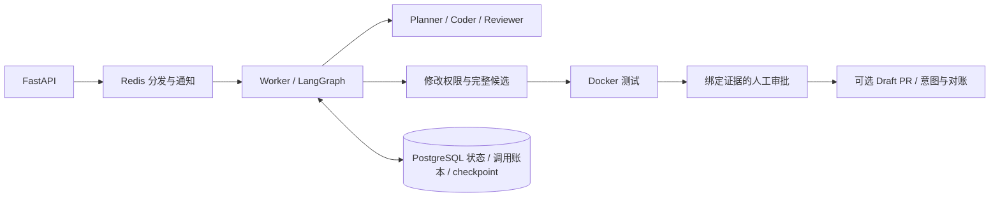

# RepoPilot

**面向 Python 仓库的、可恢复且受人工审批约束的代码修复 Agent 系统。**

接收 Issue，检索仓库代码，生成候选修改，在隔离环境运行测试，再经过模型审查与人工审批。
项目重点是修改权限、候选与测试证据一致性、调用预算和审批点恢复。

这是独立学习与作品集项目，架构思路参考 [LangChain Open-SWE](https://github.com/langchain-ai/open-swe)。
当前面向可信单用户环境。真实模型修复质量、程序控制能力和 Mock 流程验证分别记录。

[快速开始](#快速开始) · [核心能力](#核心能力) · [系统架构](#系统架构) · [验证与评测](#验证与评测) · [项目结构](#项目结构) · [文档导航](#文档导航)

## 快速开始

需要 Docker Engine / Desktop、Compose v2、Make 和 Git。完整服务验证还需要宿主 Python 3，
用于少量辅助脚本；项目 SDK 和测试依赖运行在容器内。

在仓库根目录执行：

```sh
make demo     # 无密钥演示：实际测试失败 → 有界返工 → 测试通过 → 模拟审批恢复
make check    # 锁安装、lint、快测试与 10 场景 Mock 回归
make doctor   # 依赖、配置和内置资源检查，不连接模型
make verify   # 独立 PostgreSQL / Redis / Docker 故障矩阵与实际 Worker 审批重启
```

构建阶段需要下载缺少的依赖。演示和 Mock 验证不消耗模型额度。
`make demo` 使用固定夹具和同进程内存 checkpoint，跨进程 Worker 恢复由 `make verify` 单独验证。
详细说明见[演示手册](docs/guides/demo.md)和[安装与验证](docs/guides/reproducible-delivery.md)。

启动长期运行的本地服务：

```sh
cp -n .env.example .env
docker compose up --build -d
```

示例配置默认使用 Mock，API 文档位于 <http://localhost:8000/docs>。
已有 `.env` 的 provider 选择由其配置决定。
真实模型、Reviewer override 和私有授权配置见[模型接入](docs/guides/model-providers.md)。
任务创建、绑定审批与确定性 smoke 操作见[任务 API 手册](docs/guides/task-api.md)。

## 核心能力

- **显式图编排**：LangGraph 编排 Planner、Coder、Reviewer 三种模型角色，Researcher 与
  Test Analyst 为确定性只读节点；支持 `workflow / oneshot / auto` 和有界返工。
- **集中修改边界**：程序校验精确路径、修改意图、内容摘要和整批权限；默认测试与构建配置只读。
- **完整候选与审批绑定**：独立暂存、完整 artifact 校验、数据库 CAS 选择代次，
  测试证据和一次性人工决定绑定同一候选。
- **持久化调用治理**：各角色、策略纠正和 transport retry 共享任务账本；
  请求前预留，失败及未知响应仍计数，重启不清零。
- **隔离测试与恢复**：Docker 测试使用一次性候选副本和资源限制；PostgreSQL checkpoint
  支持已经验证的审批点 Worker 重启续跑。
- **受控发布**：显式启用后才允许创建 Draft PR；发布意图固定获批版本，响应丢失先对账，
  基线移动阻断后续发布并要求重新测试与审批。
- **可解释检索与独立验收**：BM25、Python AST 符号、路径匹配和一跳依赖扩展；
  可见测试与 evaluator 独立验收分离。

## 系统架构



Redis 负责分发和实时通知，PostgreSQL 保存权威状态。主服务 Compose 在 API / Worker 启动前
运行数据库迁移。更新已有部署时，应停止旧 Worker、备份 SQL 与 artifact，再执行前向迁移。

图路由、事务边界和恢复范围见[架构说明](docs/architecture/overview.md)及
[运行时契约](docs/architecture/runtime-correctness.md)。

## 验证与评测

| 证据 | 已记录结果 | 范围 |
| --- | --- | --- |
| 2026-10-24 完整服务 CI | 555 passed / 0 skipped，行覆盖率 87.07% | 历史 CH-19 源码身份；Mock 10/10、API smoke 与两种策略的 Worker 审批重启通过 |
| 2026-09-09 单项目真实评测 | oneshot 15/20，workflow 13/20；请求 22 与 69 | The Fuck 的 20 个固定历史缺陷，未证明多角色提高修复率 |
| 同批无模型检索诊断 | 预算内目标文件覆盖 20/20，Recall@3 95% | 默认 12 文件 / 70,000 字符，指标衡量文件检索 |
| 冻结跨项目语料 | 23 例 / 3 项目，23/23 聚焦 buggy/fixed 复现 | The Fuck 20、tqdm 1、Cookiecutter 2 |
| 2026-10-23 三策略对照 | 3 缺陷 × 3 策略 × 2 轮，每策略 0/6 | 18 执行单元，16 completed、2 failed；无质量或路由收益结论 |

上述数字来自各自固定版本，不代表本次目录整理后的重新验收。
最新维护记录见[目录整理说明](docs/project/repository-layout.md)，证据分母与来源见
[能力证据索引](docs/evidence-index.md)和[评测总览](docs/evaluation/overview.md)。

当前边界：

- 审批点恢复已有实际 Worker 验证；队列 ACK、自动崩溃重领、续租和 Worker fencing 尚未实现。
- 发布故障验证使用 HTTP 模拟远端；真实 GitHub 发布器端到端验收仍未完成。
- Docker socket 是受信任的管理边界；容器隔离仍共享宿主内核。
- provider usage 不完整时保留未知值，调用次数上限不能解释为精确金额上限。
- 当前没有多租户权限、GitHub App / Webhook 或审批管理前端。

## 项目结构

```text
.
├── src/repopilot/          # 应用、图编排、存储、模型和评测运行代码
│   ├── graph/             # 显式节点、状态和路由
│   └── migrations/        # Alembic 应用表迁移
├── tests/                 # 单元、边界、服务故障及兼容性回归
├── scripts/
│   ├── development/       # 服务验证、迁移检查、smoke 和 Worker 恢复
│   ├── experiments/       # 真实评测、检索诊断和冻结语料检查
│   └── tools/             # 审批载荷、模型连接检查和验证汇总
├── docker/
│   ├── sandbox/           # 测试 sandbox 镜像
│   ├── evaluation/        # 真实缺陷环境和评测工具镜像
│   └── verification/      # 专项 Compose 与可选依赖缓存 Dockerfile
├── docs/
│   ├── architecture/      # 当前架构与行为契约
│   ├── guides/            # 安装、演示和模型接入
│   ├── evaluation/        # 评测协议、历史结果和失败观察
│   ├── verification/      # 按日期保留的专项验收记录
│   ├── project/           # 交付状态、设计取舍和版本材料
│   ├── archive/           # 旧计划、中断记录和阶段交接
│   └── evidence/          # 保持原字节的公开机器证据
├── evals/                 # 评测夹具、冻结语料、协议与来源
├── examples/              # 自有演示与确定性基准夹具
├── delivery/              # 基础镜像身份
├── requirements/          # 安装工具及其锁定要求
├── Dockerfile             # 主服务和 integration-test 构建入口
├── docker-compose.yml     # 主服务入口
├── docker-compose.chatgpt.yml
├── Makefile               # 稳定的开发与验证命令
├── pyproject.toml
├── uv.lock
└── Openspec.md            # 现有单文件规范与路线图
```

目录职责与迁移对照见[整理记录](docs/project/repository-layout.md)。
`reports/`、`workspaces/` 和私有授权数据在本地保存，按现有忽略规则管理。

## 开发与验证入口

| 命令 | 用途 |
| --- | --- |
| `make check` | lint、快测试和 Mock 回归；需要服务的用例会明确 skip |
| `make verify` | 独立服务故障矩阵、完整测试、来源核对和清理 |
| `make migration-test` / `make ch10-migration-test` | 专用数据库迁移与预算账本检查 |
| `make smoke` / `make smoke-recovery` | 检查调用者已配置的运行实例及审批恢复 |
| `make eval` | 10 个确定性 Mock 场景 |
| `make eval-real-reproduce` | 按固定镜像复现历史语料，需要提前准备缓存 |
| `make eval-real-retrieval` | 无模型的 issue-only 检索诊断 |
| `make eval-real` | 按协议运行真实模型，需要适用预算和私有配置 |

完整服务验证中的 skip 不计为通过；真实调用和发布授权分别按协议执行。
本地 Python 环境、镜像准备和 CI 触发条件见[安装手册](docs/guides/reproducible-delivery.md)。

## 文档导航

| 想了解什么 | 阅读入口 |
| --- | --- |
| 从哪里开始 | [文档首页](docs/README.md) |
| 运行演示和真实任务 | [演示手册](docs/guides/demo.md) |
| 系统设计与一致性边界 | [架构](docs/architecture/overview.md) · [候选代次](docs/architecture/candidate-generations.md) · [人工审批](docs/architecture/candidate-approvals.md) |
| 模型接入与调用预算 | [模型配置](docs/guides/model-providers.md) · [调用控制](docs/architecture/model-call-control.md) |
| 实验如何验证、已有结果如何解释 | [评测总览](docs/evaluation/overview.md) · [三策略结果](docs/evaluation/real-evaluation-results-2026-10-23.md) |
| 已有交付与验证来源 | [交付状态](docs/project/delivery-status-2026-10-24.md) · [证据索引](docs/evidence-index.md) |
| 后续开发与参与规则 | [项目规范](Openspec.md) · [贡献指南](CONTRIBUTING.md) · [仓库约定](AGENTS.md) |
| 脚本和镜像位置 | [脚本导航](scripts/README.md) · [Docker 导航](docker/README.md) |

`Openspec.md` 继续作为既有单文件规范；本次目录整理没有初始化 OpenSpec CLI，
也没有将路线图中的待实现项转换为已交付规格。

## License

MIT。第三方语料、许可及来源见 [THIRD_PARTY_NOTICES.md](THIRD_PARTY_NOTICES.md)。
